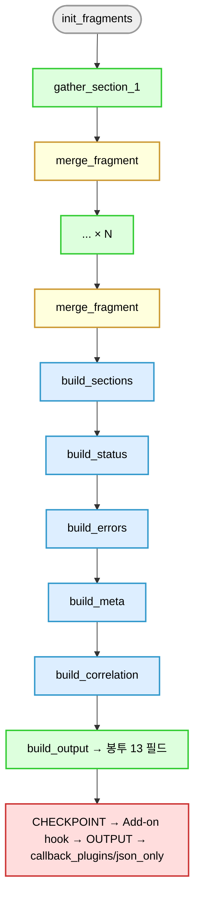

# common/tasks/normalize/: fragment 정규화 빌더

각 gather 태스크는 자기 fragment만 만들고, 이 디렉터리의 빌더가 fragment를 누적 변수에 모아 봉투 13 필드로 조립합니다. 과정 설명은 `docs/develop/02-normalize-flow.md`에 있습니다.

## 빌더 역할표

| 파일 | 입력 | 출력 | 책임 |
|---|---|---|---|
| `init_fragments.yml` | 없음 | `_merged_data` 빈 뼈대, 누적 list 5개 | 수집 시작 때 누적 변수 초기화 (필수 호출) |
| `merge_fragment.yml` | fragment 변수 5개 | `_merged_data`와 누적 list 갱신 | gather마다 fragment를 누적 변수에 병합 (필수 호출) |
| `build_sections.yml` | `_all_sec_supported`, `_all_sec_collected`, `_all_sec_failed`, `_all_sec_unsupported` | `_norm_sections` (11 섹션 × success, failed, not_supported) | 섹션별 상태 |
| `build_status.yml` | `_norm_sections` | `_out_status` (success, partial, failed) | 전체 상태. `errors`는 쓰지 않습니다 |
| `build_errors.yml` | `_all_errors` | `_norm_errors` | `{section, message, detail}` 정규화와 중복 제거 |
| `build_meta.yml` | 시작 시각, 선택된 어댑터, Ansible 버전 | `_meta` | started_at, finished_at, duration_ms, adapter_id, adapter_version, ansible_version |
| `build_correlation.yml` | `_merged_data`, `_out_ip` | `_correlation` | serial_number, system_uuid, bmc_ip, host_ip |
| `resolve_vendor.yml` | 감지된 벤더, DMI 제조사 | `_out_vendor` | `vendor_aliases.yml`의 호출자 표시값 |
| `build_output.yml` | 위 결과 전부 | `_output` (봉투 12 필드. `schema_version`은 `site.yml`이 붙입니다) | 최종 봉투 조립 |
| `build_empty_data.yml` | 없음 | 빈 섹션 뼈대 | rescue 경로에서 `_merged_data` 대체 |
| `build_failed_output.yml` | rescue 문맥 | `_output` (`status: failed` 봉투) | 수집에 들어가기 전에 멈춘 서버의 봉투 |

## 호출 순서

## fragment 변수

각 gather가 설정하는 변수 5개입니다. 이름은 공통이고 값은 자기 섹션만 담습니다.

- `_data_fragment` (dict)
- `_sections_supported_fragment` (list)
- `_sections_collected_fragment` (list)
- `_sections_failed_fragment` (list)
- `_errors_fragment` (list)

벤더나 펌웨어가 원래 주지 않는 섹션을 명시할 때만 `_sections_unsupported_fragment`도 채웁니다.

## 회귀 보호

- `init_fragments.yml`, `build_empty_data.yml`, `build_failed_output.yml`의 섹션 뼈대는 서로 같아야 합니다. 바꿀 때는 셋을 함께 고치세요.
- 봉투 13 필드와 채널 간 일관성은 `tests/regression/test_cross_channel_consistency.py`가 검사합니다.

## 관련 문서

- `docs/develop/02-normalize-flow.md`: 정규화 과정
- `docs/contract/02-output-envelope.md`, `docs/contract/03-fields.md`: 봉투와 필드 정본
