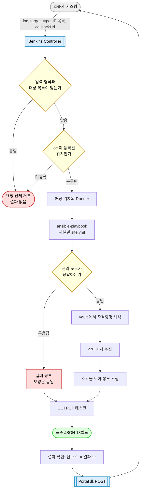

# 전체 그림

호출이 들어와서 JSON이 나갈 때까지 무슨 일이 벌어지는지 따라갑니다.

## 큰 줄기

> 이 그림이 말하는 것: 호출 한 번이 어떤 단계를 거쳐 표준 JSON이 되는가.

> 읽는 법: 위에서 아래로 흐릅니다. 노란 마름모가 갈림길입니다. 입력 확인과 위치 확인에서 거부되면 결과 자체가 없고, 그 뒤의 실패는 모두 같은 `OUTPUT` 태스크를 지나 같은 모양의 봉투가 됩니다.

## 단계별로

### 1. 호출자가 Job을 부릅니다

어느 위치에서 실행할지(`loc`), 어느 경로로 갈지(`target_type`), 대상 IP 목록(`inventory_json`), 결과를 받을 주소(`callbackUrl`)와 요청 식별자(`eventUuid`, `deploymentEnvironmentId`)를 넘깁니다. 자격증명은 넘기지 않습니다.

운영 파이프라인은 `Jenkinsfile_portal` 하나입니다. Runner 위의 Ansible 실행환경은 `scripts/activate_ansible_venv.sh`가 고르므로 서버마다 다른 venv 경로가 파이프라인에 적히지 않습니다.

### 2. 입력을 확인하고 위치를 정합니다

처음 두 단계는 Controller에서 Runner 없이 돕니다. 입력 확인은 대상 목록을 각 채널의 `inventory.sh`와 같은 규칙으로 검사해, 한 대라도 틀리면 요청 전체를 거부합니다. 위치 확인은 `common/vars/locations.yml`에 등록되지 않은 `loc`이면 바로 실패시킵니다. 이 단계가 없으면 잘못된 위치 이름이 "Runner를 기다리는 중" 상태로 매달려 원인을 알기 어렵습니다.

### 3. 관리 포트를 확인합니다

수집을 시작하기 전에 대상이 응답하는지 봅니다. 채널별로 볼 포트가 정해져 있습니다. Redfish와 ESXi는 443, OS는 5986, 5985, 22 순입니다. 첫 번째로 열린 포트에서 멈춥니다.

핑은 관문이 아닙니다. 관리망은 핑을 막아 두는 경우가 흔한데, 핑을 앞단 관문으로 쓰면 멀쩡히 443으로 답하는 BMC를 죽은 장비로 오판합니다. 그래서 관리 포트를 먼저 보고, TCP가 아무 응답도 주지 않았을 때만 ICMP Echo를 한 번 더 보냅니다. `reachable`은 TCP 응답 또는 ICMP 응답입니다.

이 순서가 양쪽 오판을 모두 막습니다. 핑이 막혀 있어도 TCP가 답하면 통과이고, 방화벽이 관리 포트 TCP를 조용히 버려도 Echo가 오면 "장비는 있는데 관리 포트를 못 연다"로 구분됩니다. 후자는 `reachable` 실패가 아니라 `port` 단계 실패이고, 사용자에게 나가는 문장도 "대상 서버와 통신은 되지만 관리 포트에 연결할 수 없습니다. 방화벽과 접속 설정을 확인하세요."입니다.

OS 경로는 한 걸음 더 갑니다. 포트가 열린 것만으로는 부족해서 22면 SSH 배너를 읽고, 5985나 5986이면 인증 없이 WS-Man Identify를 보내 봅니다. 다른 서비스가 그 포트를 쓰고 있으면 다음 후보로 넘어갑니다.

### 4. 자격증명을 엽니다

vault 경로는 위치와 대상 종류로 정해집니다.

| 채널 | 경로 |
|---|---|
| OS | `vault/<loc>/os/linux.yml`, `vault/<loc>/os/windows.yml` |
| ESXi | `vault/<loc>/esxi.yml` |
| Redfish 수집 계정 | `vault/common/redfish/standard.yml` (전역 한 벌) |
| Redfish 복구 계정 | `vault/<loc>/redfish/<vendor>.yml` |

Redfish만 축이 둘인 이유는 수집은 어느 위치 어느 제조사든 같은 표준 계정으로 하고 복구만 제조사별로 다르기 때문입니다. 그래서 제조사를 못 알아내도 표준 계정은 열립니다.

### 5. 수집합니다

채널마다 구조가 다릅니다. OS는 플레이가 넷입니다. 포트로 OS 종류를 가리고, 못 가린 서버는 바로 실패 봉투로 보내고, 나머지를 Linux와 Windows로 갈라 처리합니다. ESXi와 Redfish는 플레이 하나로 끝납니다.

Linux는 한 갈래가 더 있습니다. 대상에 Python이 없거나 3.9보다 낮으면 Ansible 모듈이 돌지 않는데, 그런 환경도 버려지지 않도록 셸 명령만으로 같은 결과를 만드는 raw 경로가 따로 있습니다.

### 6. 조각을 모읍니다

각 수집 작업은 전체 JSON을 만들지 않습니다. 자기가 맡은 조각만 만들어 놓고 공용 병합기를 부릅니다. CPU를 수집하는 작업은 CPU 조각만 만들고 메모리 쪽은 건드리지 않습니다.

이렇게 하는 이유는 실패를 가둘 수 있기 때문입니다. 스토리지 수집이 실패해도 CPU 조각은 이미 모여 있으니 결과는 전부 실패가 아니라 `partial`이 됩니다.

조각이 다 모이면 공용 조립기가 봉투를 만듭니다. 어느 채널이든 같은 조립기를 쓰므로 세 경로의 응답 모양이 같습니다.

### 7. 내보내고 확인하고 전송합니다

봉투는 `OUTPUT`이라는 이름의 태스크에서 나갑니다. 출력 플러그인(`callback_plugins/json_only.py`)이 태스크 이름을 문자열 그대로 비교하므로 이름이 정확히 일치해야 하고, 이 플러그인이 Ansible의 다른 출력을 막고 봉투만 파일과 표준출력으로 내보냅니다.

수집이 끝나면 Controller에서 결과 확인 단계가 돕니다. 결과 파일을 회수해 접수한 서버 수와 결과 봉투 수를 맞춘 뒤 `callbackUrl`로 POST합니다. 수집 도중 Runner가 끊기거나 실행 한계에 닿아 일부 서버가 OUTPUT까지 못 가도, 진행 기록으로 그 서버의 실패 봉투를 만들어 수를 맞춥니다. 호출자는 "IP 3개를 보냈는데 봉투가 2개 왔다"는 상황을 처리할 필요가 없습니다. 상세는 [operate/04-pipeline-runtime.md](../operate/04-pipeline-runtime.md)에 있습니다.

## 벤더 차이는 어디에 있나

수집 코드에는 제조사 이름이 없습니다. 차이는 두 군데에만 있습니다.

어댑터 YAML은 `adapters/<채널>/` 아래에 있고 어떤 장비에 맞는지(제조사, 모델, 펌웨어 패턴)와 어떤 섹션을 지원하는지를 적습니다. 여러 개가 맞으면 점수로 하나를 고릅니다.

제조사 확장 정보는 Redfish 라이브러리(`redfish-gather/library/redfish_gather.py`)의 `_extract_oem_*` 함수가 `Oem.Dell`, `Oem.Hpe` 같은 제조사 영역에서 뽑아 `data.system.oem`, `data.bmc.oem`으로 내보냅니다.

그래서 벤더를 늘릴 때 파이프라인이나 수집 코드를 고치지 않습니다. 규칙은 [develop/03-adapter-system.md](../develop/03-adapter-system.md)에 있습니다.

## 다음

- 봉투 안이 궁금하면 [contract/02-output-envelope.md](../contract/02-output-envelope.md)
- 실패했을 때 무엇을 보는지는 [contract/04-failure-and-diagnosis.md](../contract/04-failure-and-diagnosis.md)
- 코드 구조는 [develop/01-gather-structure.md](../develop/01-gather-structure.md)
